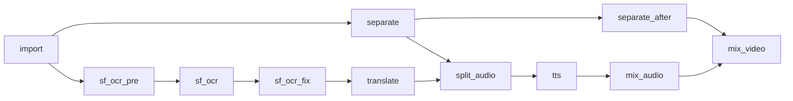

# Application Architecture

## 概览

LocalDub 是视频配音 / 字幕工具：Rust workspace 提供全部业务逻辑（`ld-core`），
桌面端（Tauri 2 + SolidJS）、CLI、HTTP server 都只是它的壳。桌面端 UI 仍在改造中。

配音流水线（`dub` + `subtitle_source=sf_ocr`，10 步）：

`import` 在引擎 DAG 之外先执行（`import_and_start` / `--action import`），所以 DAG 里
`separate` 与 `sf_ocr_pre` 是两个入度为 0 的根节点，都只依赖 import 落下的原视频。

实际执行的序列由 `output_mode`（`dub` / `subtitle`）与 `subtitle_source`
（`asr` / `sf_ocr` / `asr_ocr`）决定，共 6 种组合；**单一真源**是
`packages/core/src/steps/utils/steps.rs` 的 `steps_for`，运行时 `get_steps` 与
import 期序列都走它。

## Workspace

| 包 | 作用 |
| --- | --- |
| `packages/core`（`ld-core`） | 全部业务：步骤实现（`steps/`）、编排（`workflow/`）、env 检查与下载、状态投影（`state/`）、配置模型（`input/`） |
| `packages/cli` | CLI 入口，按 command 派发到 `cmd/` |
| `packages/app` + `ui-solid` | Tauri 2 桌面端；前端 SolidJS + TanStack Router/Query + Tailwind |
| `packages/server` | axum + fnrpc 的 HTTP 服务（与 Tauri IPC 共用同一套 RPC） |
| `packages/sdk` / `bridge` | fnrpc 的 TypeScript 绑定生成与前端桥 |
| `fs` / `paths` / `config-rs` / `device-rs` / `llm` / `pacer-rs` / `time` / `util` | 路径、配置、设备探测、LLM 客户端、限流重试等支撑 crate |

## 编排

三种执行路径（`workflow/args.rs` 的 `ExecPath`，由 `--engine` / `--parallel` 解析）：

| 路径 | 实现 | 状态真源 |
| --- | --- | --- |
| Serial（默认） | `workflow/pipeline.rs::run_pipeline` 顺序 `run_step` | 任务根 `view.json` |
| Parallel（实验） | `workflow/parallel.rs` 按 `dag.rs` 的 `StepDag` 并发 | 各 `<step>/state.json`（单写者） |
| Engine | `integration/workflow/` 驱动 aa-workflow core，DAG 即代码（`workflows/dub_sf_ocr.rs`） | `<video_dir>/workflow-store/<run_id>/logs.jsonl` |

- 每步的入参是它自己的 `XxxInput` / `XxxDeps`（显式依赖清单），**跨步骤数据一律走盘上
  产物**，没有"什么都装"的组合态在步骤之间传递。
- 状态文件（`view.json`、`<step>/state.json`）是**投影**，可丢弃可重建；引擎的
  resume / resume_from / target_step 只认事件日志。详见 `AGENTS.md`。
- 每步执行前会重读 `input.json`，因此 resume / regen 改写配置后立即生效
  （`pipeline.rs`）。

## 外部运行时

| 阶段 | 实现 | 分发方式 |
| --- | --- | --- |
| separate | demucs-burn（wgpu/Vulkan，htdemucs） | vox-lab release → `data/bin/demucs-wgpu` |
| asr | whisper-vulkan | vox-lab release |
| sf_ocr / asr_ocr | subtitle-finder 提关键帧 + subtitle-ocr 识别 | vision-lab release → `data/bin/` |
| translate | 云端 LLM | HTTP API |
| tts | VoxCPM（cloud） | HTTP API |
| mix_audio / mix_video | ffmpeg | 系统或随包 |
| import | ffmpeg + yt-dlp（远端源） | 同上 |

Release 二进制的资产清单（三平台 + sha256）定义在
`packages/core/src/cmd/env/items.rs` 的 `ReleaseBinSpec`；`ld-core::cmd::env` 的
check / ensure 负责下载、校验并补执行位。

## 硬件与已知限制

- GPU 兼容性、MES hang 等见 `.agents/hardware.md`、`docs/gpu-status.md`
- WebGPU `VK_ERROR_DEVICE_LOST` 根因见 `docs/webgpu-oom.md`
- 模型设备分配策略见 `.agents/model-strategy.md`
